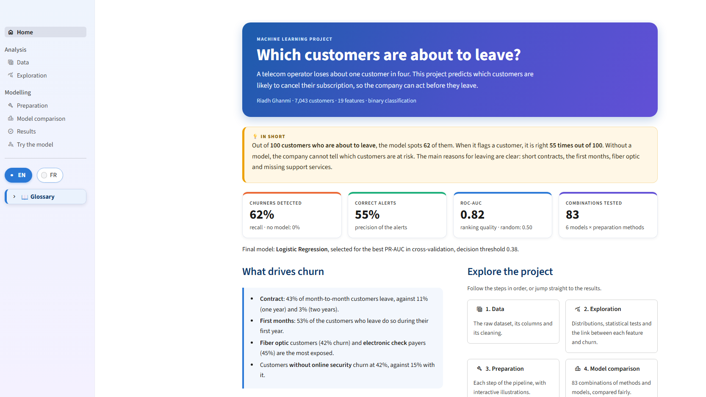
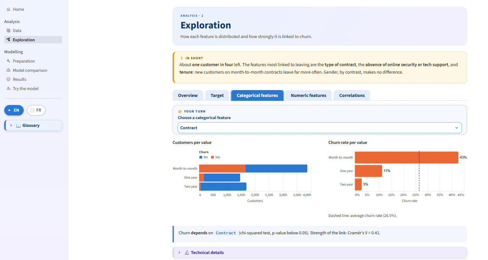
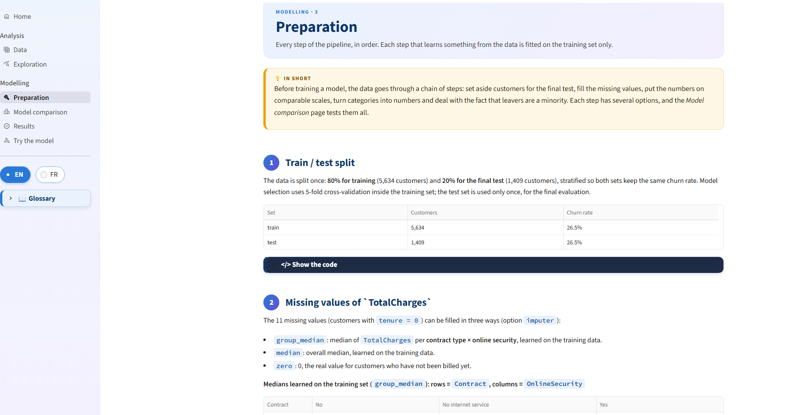
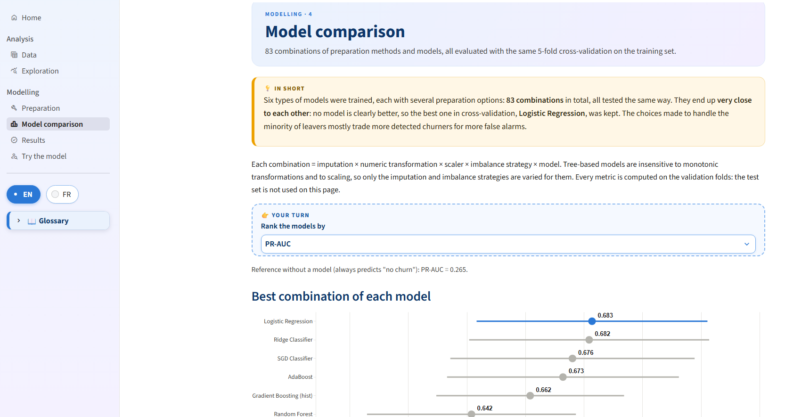
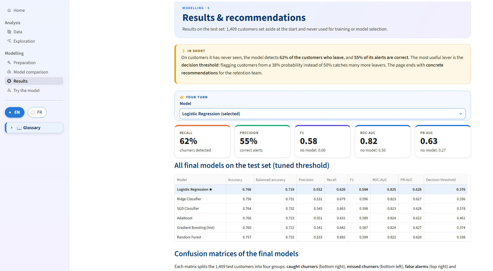
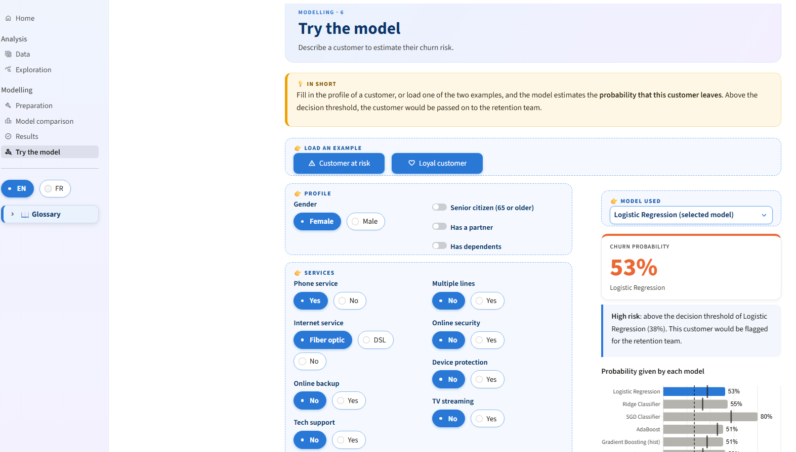

[English](README.md) · **Français**

# Churn client — quels clients sont sur le point de partir ?

[](https://customer-churn-ghriadh.streamlit.app/) **Application en ligne :** https://customer-churn-ghriadh.streamlit.app/

Un opérateur télécom perd environ un client sur quatre. Ce projet prédit quels clients risquent de résilier leur
abonnement, pour qu'une équipe de fidélisation puisse les contacter avant leur départ. Il couvre toute la démarche :
exploration, pipeline de préparation sans fuite de données, comparaison équitable des méthodes de préparation et des
modèles, ajustement du seuil de décision, interprétation et recommandations métier. Une application Streamlit
bilingue (anglais / français) présente le travail avec des graphiques interactifs.



## Résultats

Le modèle final est une **régression logistique**, retenue pour la meilleure PR-AUC en validation croisée. Sur le jeu
de test (1 409 clients mis de côté dès le départ, jamais utilisés pour l'entraînement ni pour le choix du modèle) :

| Métrique | Valeur | Référence sans modèle |
|---|---|---|
| Rappel (clients partants détectés) | **62 %** | 0 % |
| Précision (alertes justes) | **55 %** | — |
| F1 | 0,58 | 0,00 |
| ROC-AUC | 0,82 | 0,50 |
| PR-AUC | 0,63 | 0,27 |

- Sur 100 clients qui vont partir, le modèle en repère 62. Quand il signale un client, il a raison 55 fois sur 100.
- L'ajustement du seuil de décision (0,38 au lieu de 0,5) est le levier le plus utile : le rappel passe de 49 % à
  62 %, pour une baisse modérée de la précision (64 % → 55 %).
- Les six modèles finaux sont à quelques centièmes les uns des autres : la limite vient de l'information contenue
  dans les données, pas du choix de l'algorithme. La régression logistique est aussi la plus facile à expliquer.

## Ce qui fait partir les clients

- **Contrat :** 43 % des clients sans engagement partent, contre 11 % avec un contrat d'un an et 3 % avec un contrat
  de deux ans.
- **Premiers mois :** 53 % des clients qui partent le font pendant leur première année.
- **Services :** les clients sans sécurité en ligne partent à 42 %, contre 15 % avec. Les clients fibre (42 %) et
  ceux qui paient par chèque électronique (45 %) sont les plus exposés.
- **Factures :** les clients qui partent paient plus cher par mois en moyenne, mais à type d'internet égal ils paient
  un peu *moins* ; leur facture plus élevée reflète l'offre fibre.

Ces constats donnent six recommandations (contrats plus longs, accompagnement des nouveaux clients, services
d'assistance, offre fibre, prélèvement automatique, priorisation avec le score du modèle), détaillées dans
l'application et le notebook.

## Méthode

1. **Données :** jeu IBM Telco Customer Churn, 7 043 clients, 19 variables, cible binaire (26,5 % de churn).
   `customerID` est retiré ; les 11 `TotalCharges` vides (tous avec une ancienneté de 0) deviennent des valeurs
   manquantes.
2. **Séparation d'abord :** découpage stratifié 80/20 entraînement/test avant toute étape qui apprend des données.
3. **Un seul pipeline** (`imblearn.pipeline.Pipeline`) enchaîne toutes les étapes apprises : il est ajusté sur les
   données d'entraînement uniquement, et réajusté sur chaque pli de la validation croisée :
   - valeurs manquantes : médiane par type de contrat et sécurité en ligne (transformateur scikit-learn
     personnalisé), médiane globale ou 0 ;
   - transformation numérique : aucune, log1p, racine carrée ou Yeo-Johnson ;
   - mise à l'échelle : standard, min-max ou robuste ;
   - encodage one-hot ;
   - déséquilibre des classes : aucun traitement, `class_weight`, sur- ou sous-échantillonnage aléatoire, SMOTE
     (appliqué aux plis d'entraînement uniquement).
4. **Comparaison :** neuf modèles passés en revue, puis 83 combinaisons de méthodes de préparation pour les six
   retenus (régression logistique, ridge, SGD, forêt aléatoire, gradient boosting par histogrammes, AdaBoost), toutes
   avec la même validation croisée stratifiée à 5 plis. La métrique de sélection est un paramètre (PR-AUC par défaut).
5. **Réglage :** pour chaque modèle, `GridSearchCV` sur sa meilleure combinaison, puis `TunedThresholdClassifierCV`
   pour le seuil de décision (F1 par défaut).
6. **Évaluation :** chaque modèle final est évalué une seule fois sur le jeu de test ; interprétation par importance
   par permutation et coefficients de la régression logistique.
7. **Expériences complémentaires** (notebook) : sélection de variables (RFE, seuils sur les coefficients et les
   importances), ACP, modèles empilés et réseaux de neurones. Aucune ne fait mieux que la régression logistique.

## L'application Streamlit

Six pages suivent le projet étape par étape, chacune avec un résumé en langage courant, le code, les résultats et
les détails techniques : **Données**, **Exploration**, **Préparation**, **Comparaison des modèles**, **Résultats** et
**Tester le modèle** (décrire un client et obtenir sa probabilité de départ selon chaque modèle). Un bouton permet de
passer de l'anglais au français.

| | |
|---|---|
|  |  |
|  |  |



## Structure du projet

```
├── app/                      application Streamlit
│   ├── Home.py               point d'entrée et navigation
│   ├── common.py             styles, blocs de mise en page, graphiques, chargements en cache
│   ├── i18n.py               bascule anglais / français
│   └── pages/                Données, Exploration, Préparation, Comparaison, Résultats, Tester le modèle
├── artifacts/                résultats enregistrés : modèles entraînés, validation croisée, métriques, prédictions
├── data/customer_churn.csv   jeu de données
├── docs/screenshots/         captures de l'application
├── notebooks/
│   └── customer_churn.ipynb  l'analyse complète, avec ses sorties
├── src/churn/                paquet Python utilisé par l'application, le notebook et le script d'entraînement
│   ├── data.py               chargement, nettoyage sans apprentissage, séparation entraînement/test
│   ├── transformers.py       GroupMedianImputer (compatible scikit-learn)
│   ├── pipeline.py           build_pipeline() : chaque option de préparation et chaque modèle en paramètre
│   ├── evaluation.py         métriques, comparaison en validation croisée
│   ├── train.py              entraînement de bout en bout, écrit dans artifacts/
│   ├── prediction.py         charger un modèle enregistré et prédire de nouveaux clients
│   └── stats.py              tests statistiques utilisés dans l'exploration
├── run_pipeline.py           entraînement en ligne de commande
└── requirements.txt
```

## Démarrage

Développé et testé avec Python 3.14.

```bash
python -m venv venv
venv\Scripts\activate            # Windows   (macOS / Linux : source venv/bin/activate)
pip install -r requirements.txt  # installe aussi le paquet churn en mode éditable

streamlit run app/Home.py        # l'application, à partir des résultats enregistrés dans artifacts/
```

Réentraîner les modèles (environ 2 minutes ; les résultats sont écrits dans `artifacts/`) :

```bash
python run_pipeline.py                                    # sélection par PR-AUC, seuil par F1
python run_pipeline.py --metric f1 --threshold-metric f2  # autres critères
python run_pipeline.py --quick                            # petite grille, pour une vérification rapide
```

Ouvrir le notebook (il importe le paquet `churn` et se réexécute de haut en bas) :

```bash
pip install jupyterlab
jupyter lab notebooks/customer_churn.ipynb
```

Prédire depuis Python :

```python
from churn.prediction import load_model, predict

model = load_model()                 # le modèle retenu
predict([client], model)             # client : dict des 19 variables -> churn_probability, churn
```

## Technologies

pandas · NumPy · SciPy · scikit-learn · imbalanced-learn · Streamlit · Altair · Matplotlib · seaborn · Jupyter
