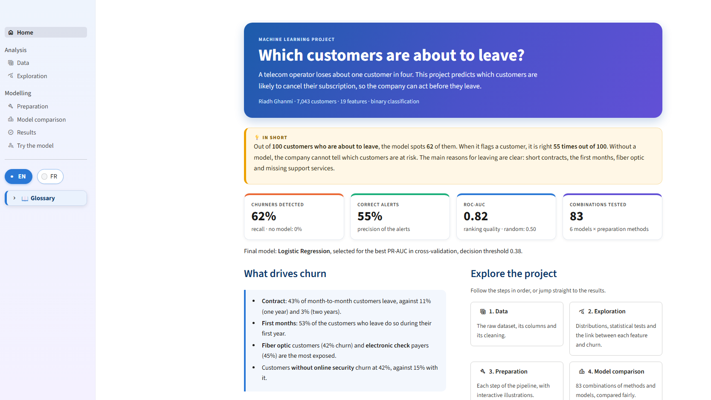
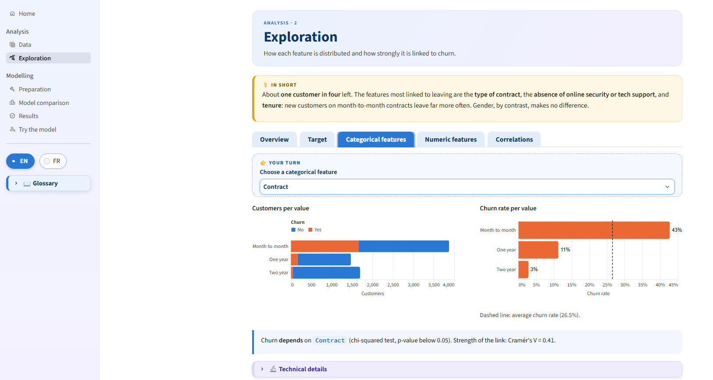
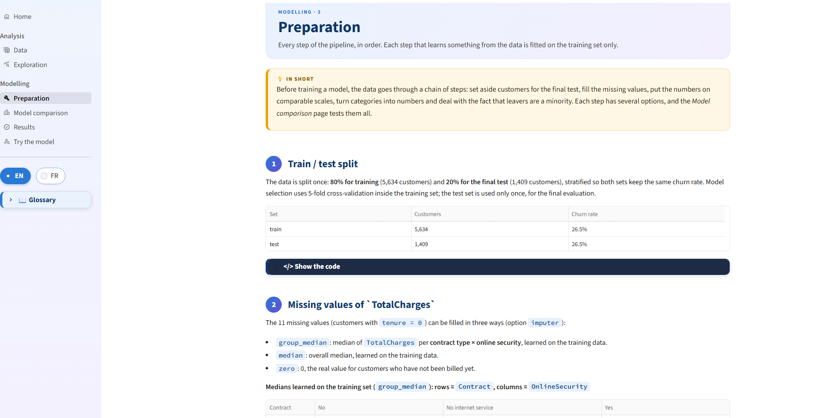
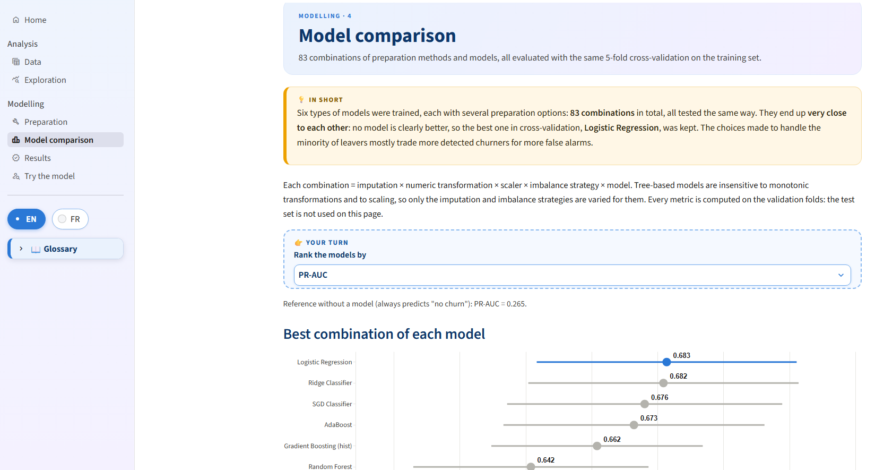
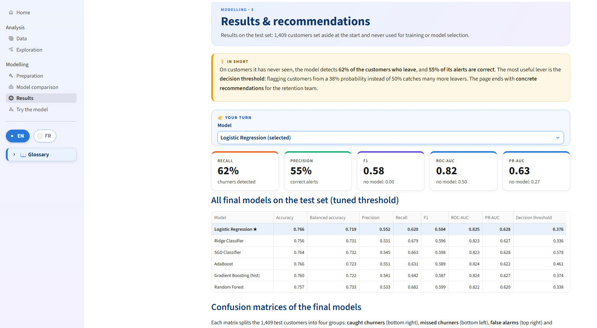
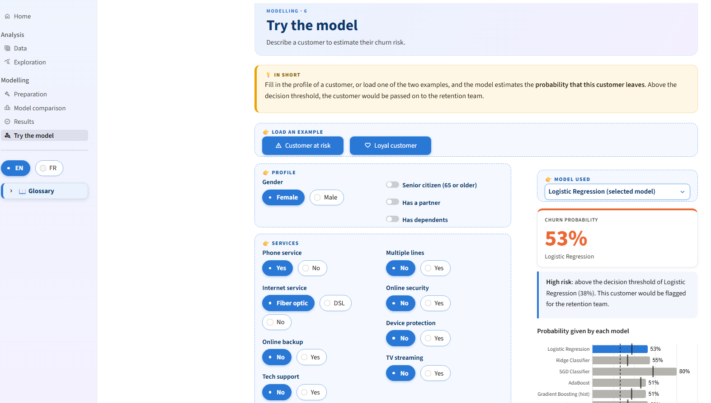

**English** · [Français](README.fr.md)

# Customer Churn — which customers are about to leave?

A telecom operator loses about one customer in four. This project predicts which customers are likely to cancel
their subscription, so that a retention team can contact them before they leave. It covers the whole workflow:
exploration, a leak-free preprocessing pipeline, a fair comparison of preparation methods and models, threshold
tuning, interpretation and business recommendations. A bilingual Streamlit app (English / French) presents the work
with interactive charts.



## Results

The final model is a **logistic regression**, selected for the best PR-AUC in cross-validation. On the test set
(1,409 customers set aside at the start and never used for training or model selection):

| Metric | Value | Reference without a model |
|---|---|---|
| Recall (churners detected) | **62%** | 0% |
| Precision (correct alerts) | **55%** | — |
| F1 | 0.58 | 0.00 |
| ROC-AUC | 0.82 | 0.50 |
| PR-AUC | 0.63 | 0.27 |

- Out of 100 customers who are about to leave, the model flags 62. When it flags a customer, it is right 55 times
  out of 100.
- Tuning the decision threshold (0.38 instead of 0.5) is the most useful lever: recall goes from 49% to 62%, for a
  moderate loss of precision (64% → 55%).
- The six final models score within a few hundredths of each other: the limit comes from the information in the
  data, not from the choice of algorithm. The logistic regression is also the easiest to explain.

## What drives churn

- **Contract:** 43% of month-to-month customers leave, against 11% with a one-year contract and 3% with a two-year
  contract.
- **First months:** 53% of the customers who leave do so during their first year.
- **Services:** customers without online security churn at 42%, against 15% with it. Fiber optic customers (42%)
  and electronic check payers (45%) are the most exposed.
- **Bills:** churners pay more per month overall, but within each internet type they pay slightly *less*; their
  higher bills reflect the fiber optic offer.

These findings lead to six recommendations (longer contracts, onboarding of new customers, support services, fiber
offer, automatic payment, prioritisation with the model score), detailed in the app and the notebook.

## Method

1. **Data:** IBM Telco Customer Churn dataset, 7,043 customers, 19 features, binary target (26.5% churn).
   `customerID` is dropped; the 11 blank `TotalCharges` (all with tenure = 0) become missing values.
2. **Split first:** stratified 80/20 train/test split before any step that learns from the data.
3. **One pipeline** (`imblearn.pipeline.Pipeline`) chains every learned step, so it is fitted on training data only
   and refitted on each cross-validation fold:
   - missing values: median by contract type and online security (custom scikit-learn transformer), overall
     median, or 0;
   - numeric transformation: none, log1p, square root or Yeo-Johnson;
   - scaling: standard, min-max or robust;
   - one-hot encoding;
   - class imbalance: none, `class_weight`, random over- or under-sampling, SMOTE (applied to training folds only).
4. **Comparison:** nine models screened, then 83 combinations of preparation methods for the six kept (logistic
   regression, ridge, SGD, random forest, histogram gradient boosting, AdaBoost), all with the same stratified
   5-fold cross-validation. The selection metric is a parameter (PR-AUC by default).
5. **Tuning:** for each model, `GridSearchCV` on its best combination, then `TunedThresholdClassifierCV` for the
   decision threshold (F1 by default).
6. **Evaluation:** each final model is evaluated once on the test set; interpretation with permutation importance
   and logistic regression coefficients.
7. **Additional experiments** (notebook): feature selection (RFE, coefficient and importance thresholds), PCA,
   stacking and neural networks. None improves on the logistic regression.

## The Streamlit app

Six pages follow the project step by step, each with a plain-language summary, the code, the results and the
technical details: **Data**, **Exploration**, **Preparation**, **Model comparison**, **Results** and **Try the
model** (describe a customer and get their churn probability from each model). A toggle switches between English and
French.

| | |
|---|---|
|  |  |
|  |  |



## Project structure

```
├── app/                      Streamlit app
│   ├── Home.py               entry point and navigation
│   ├── common.py             styles, layout blocks, charts, cached loaders
│   ├── i18n.py               English / French toggle
│   └── pages/                Data, Exploration, Preparation, Model comparison, Results, Try the model
├── artifacts/                saved results: trained models, CV results, metrics, test predictions
├── data/customer_churn.csv   dataset
├── docs/screenshots/         screenshots of the app
├── notebooks/
│   └── customer_churn.ipynb  the full analysis, with outputs
├── src/churn/                Python package used by the app, the notebook and the training script
│   ├── data.py               loading, stateless cleaning, train/test split
│   ├── transformers.py       GroupMedianImputer (scikit-learn compatible)
│   ├── pipeline.py           build_pipeline(): every preparation option and model as a parameter
│   ├── evaluation.py         metrics, cross-validated comparison
│   ├── train.py              end-to-end training, saves artifacts/
│   ├── prediction.py         load a saved model and predict new customers
│   └── stats.py              statistical tests used in the exploration
├── run_pipeline.py           command-line training
└── requirements.txt
```

## Getting started

Developed and tested with Python 3.14.

```bash
python -m venv venv
venv\Scripts\activate            # Windows   (macOS / Linux: source venv/bin/activate)
pip install -r requirements.txt  # also installs the churn package in editable mode

streamlit run app/Home.py        # the app, using the saved results in artifacts/
```

Retrain the models (about 2 minutes; results are written to `artifacts/`):

```bash
python run_pipeline.py                                    # PR-AUC selection, F1 threshold
python run_pipeline.py --metric f1 --threshold-metric f2  # other criteria
python run_pipeline.py --quick                            # small grid, for a fast check
```

Open the notebook (it imports the `churn` package and reruns from top to bottom):

```bash
pip install jupyterlab
jupyter lab notebooks/customer_churn.ipynb
```

Predict from Python:

```python
from churn.prediction import load_model, predict

model = load_model()                 # the selected model
predict([customer], model)           # customer: dict of the 19 features -> churn_probability, churn
```

## Tech stack

pandas · NumPy · SciPy · scikit-learn · imbalanced-learn · Streamlit · Altair · Matplotlib · seaborn · Jupyter
